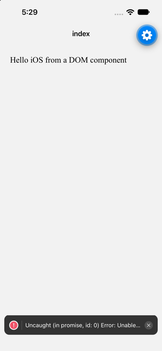

# expo-dom-ios-mount-rejection-repro

Minimal reproduction: mounting a single `'use dom'` component on **iOS** logs an
unhandled promise rejection on every cold start:

```
Uncaught (in promise, id: 0) Error: Unable to find the 'DomWebView' view with tag '12'
```

- expo 58.0.21, @expo/dom-webview 58.0.2, expo-router 58.0.28
- Expo Go on the iOS 27 simulator (iPhone 16), Xcode 27

## Steps

1. `npm install`
2. `npx expo start --ios`
3. Wait for the app to load. No interaction is needed.

**Expected:** "Hello iOS from a DOM component" renders and nothing is logged.

**Actual:** it renders, and LogBox reports the rejection above. It happened on
3 of 3 cold starts (`xcrun simctl terminate` then reopen), always for the first
DomWebView tag of the new runtime.

## Where it comes from

`expo/src/dom/webview-wrapper.tsx` sends props with `emit()` from a
`useEffect`, which calls `webviewRef.current?.injectJavaScript(...)`. On iOS
that is an `AsyncFunction` (`@expo/dom-webview/ios/DomWebViewModule.swift`)
whose view lookup rejects while the native view is not registered yet, and
`emit()` does not handle the returned promise.

Related Android reports: expo/expo#47469, expo/expo#50679 (closed by the bot for a
missing repro; it noted "Not seen on iOS"), expo/expo#49173.


